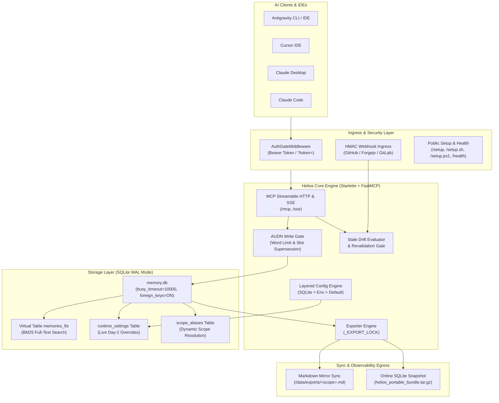
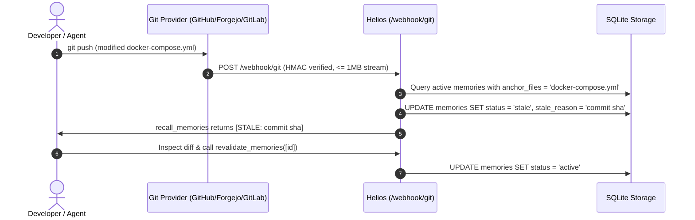
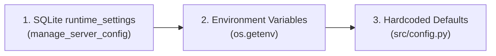

# Helios — Centralized MCP Memory Engine

**Helios** is a token-budgeted Model Context Protocol (MCP) shared memory engine built for AI coding agents across IDEs, CLIs, local networks, and cloud deployments.

It provides sub-millisecond full-text retrieval via **SQLite FTS5 (BM25)**, deterministic **AUDN (Add / Update / Deprecate / No-op)** write gates, **universal Git webhook drift detection** (GitHub, Forgejo, Gitea, GitLab), **live Day-2 runtime configuration**, **zero-trust authentication**, and dual-faced **Markdown + portable `.tar.gz` exports**.

---

## 1. Quick Start: Server Deployment

### 1.1 Docker Compose Deployment
```bash
# Clone the repository
git clone https://forgejo.braserver.site/braz/helios.git
cd helios

# Configure environment & directories
cp .env.example .env
cp docker-compose.example.yml docker-compose.yml
mkdir -p data

# Optional: Seed initial architecture rules on cold-boot
cp seed.example.yaml data/seed.yaml

# Start Helios container
docker compose up -d --build
```

### 1.2 Core Environment Variables
| Variable | Default | Description |
| :--- | :--- | :--- |
| `MEMORY_DATA_DIR` | `/data` | Path inside container where SQLite (`memory.db`) and Markdown exports live. |
| `HELIOS_API_KEY` | `""` (Open Mode) | Zero-trust authentication key. Enables constant-time `hmac.compare_digest` verification. |
| `HELIOS_WEBHOOK_SECRET` | `""` | Shared secret for validating incoming Git push webhooks (`POST /webhook/git`). |
| `HELIOS_REQUIRE_WEBHOOK_SECRET` | `false` | Enforce fail-closed rejection (`HTTP 503`) if `HELIOS_WEBHOOK_SECRET` is unset. |
| `HELIOS_PUBLIC_URL` | `""` | Public/mesh base URL override for client `/setup` generation (e.g. `https://helios.example.com`). |
| `HELIOS_WORD_LIMIT` | `25` | Maximum words allowed per atomic memory statement (5–200). |
| `HELIOS_EPISODIC_TTL_DAYS` | `14` | Days before unaccessed `episodic` memories are archived (1–365). |
| `HELIOS_GIT_PROVIDER` | `""` | Git provider (`forgejo`, `gitea`, `github`, `gitlab`). |
| `HELIOS_GIT_API_URL` | `""` | Base API URL of your Git server (e.g., `https://git.example.com`). |
| `HELIOS_GIT_TOKEN` | `""` | Personal Access Token with repo/webhook permissions. |
| `HELIOS_WEBHOOK_URL` | `""` | Target webhook URL registered on Git providers. |

---

## 2. Quick Start: Client Installation for AI Agents

Helios provides zero-friction, multi-client onboarding across **Antigravity**, **Cursor**, **Claude Desktop**, and **Claude Code** on **Linux**, **macOS**, and **Windows**.

### 2.1 Instant 1-Liner Automated Setup (Recommended)
Run the automated installation script directly in your terminal:

- **Linux / macOS (Bash)**:
  ```bash
  curl -fsSL https://<your-helios-host>/setup.sh | bash
  ```
  *Headless server CLI role:*
  ```bash
  curl -fsSL "https://<your-helios-host>/setup.sh?role=server-cli" | bash
  ```

- **Windows (PowerShell)**:
  ```powershell
  irm https://<your-helios-host>/setup.ps1 | iex
  ```
  *Headless server CLI role:*
  ```powershell
  irm "https://<your-helios-host>/setup.ps1?role=server-cli" | iex
  ```

> [!TIP]
> **Multi-Client Auto-Detection**:
> The 1-liner scripts automatically detect your active developer tools and register the Helios MCP connection into:
> - **Antigravity CLI / IDE** (`~/.gemini/config/mcp_config.json` + `GEMINI.md` + `/remember` skill)
> - **Cursor IDE** (`~/.cursor/mcp.json`)
> - **Claude Desktop** (`claude_desktop_config.json`)
> - **Claude Code CLI** (`claude mcp add`)
>
> If authentication is enabled, pass your token via query string: `curl -fsSL "https://<host>/setup.sh?token=<your_key>" | bash`.

### 2.2 Conversational AI Agent Setup (1 Prompt)
Paste this single prompt into any AI agent (Claude Code, Cursor, Antigravity):

```text
Fetch https://<your-helios-host>/setup and configure my local MCP client, global directives, and /remember skill.
```

The agent fetches `GET /setup`, identifies its client environment and OS platform, safely merges the `"helios"` configuration without overwriting other servers, installs the global directive, and installs the `/remember` skill.

### 2.3 Manual Client Configuration Snippets

#### Antigravity CLI / IDE
- **Path**: `~/.gemini/config/mcp_config.json` (Windows: `%USERPROFILE%\.gemini\config\mcp_config.json`)
```json
{
  "mcpServers": {
    "helios": {
      "url": "https://<your-helios-host>/mcp"
    }
  }
}
```

#### Cursor IDE
- **Path**: `~/.cursor/mcp.json` (Windows: `%USERPROFILE%\.cursor\mcp.json`)
```json
{
  "mcpServers": {
    "helios": {
      "url": "https://<your-helios-host>/sse"
    }
  }
}
```

#### Claude Desktop
- **macOS**: `~/Library/Application Support/Claude/claude_desktop_config.json`
- **Linux**: `~/.config/Claude/claude_desktop_config.json`
- **Windows**: `%APPDATA%\Claude\claude_desktop_config.json`
```json
{
  "mcpServers": {
    "helios": {
      "command": "npx",
      "args": ["-y", "mcp-remote", "https://<your-helios-host>/sse"]
    }
  }
}
```

#### Claude Code CLI
```bash
claude mcp add --transport sse helios https://<your-helios-host>/sse
```

### 2.4 Idempotent Delimiters & Lifecycle Management
Helios wraps global agent directives inside strict HTML comment delimiters (`GEMINI.md` / `CLAUDE.md` / `.cursor/rules/helios.mdc`):

```markdown
<!-- HELIOS:START -->
# Global Agent Directives — Helios Memory Protocol
You are connected to Helios, a centralized token-budgeted memory engine.
1. Pre-Flight Check: Always call `recall_memories(scope="<current_repo>")` at session start.
2. Stale Protocol: When a memory is marked `[STALE]`, inspect `anchor_files` before relying on it.
3. Update Rule: Persist architectural decisions, changed ports, or conventions via `save_memory()`.
4. Token Diet: Keep facts atomic (<= 25 words).
5. Wrap-Up: Run the `/remember` skill before clearing context.
<!-- HELIOS:END -->
```

- **Switching Roles**: To switch an agent between workstation coding (`workstation`) and headless server operations (`server-cli`), ask your agent:
  *"Run `get_client_setup_bundle(action='switch_role', instance_role='server-cli')` and update my directives."*
- **Clean Uninstallation**: To completely remove Helios from an environment without deleting user rules:
  *"Run `get_client_setup_bundle(action='uninstall')` and remove Helios from this machine."*

---

## 3. Core Capabilities & Invariants

- **SQLite WAL & FTS5 (BM25) Full-Text Search**:
  - Sub-millisecond indexed memory retrieval across scopes with BM25 ranking.
  - Priority ordering: `rule` (guardrails) $\rightarrow$ `fact` (architecture/ports) $\rightarrow$ `preference` (conventions) $\rightarrow$ `episodic` (temporary notes).
  - Sanitized technical token search (e.g., `192.168.1.150:8000`, `docker-compose.yml`, `v0.1.0`).

- **AUDN Write Gate (`upsert_memory()`)**:
  - Enforces strict configurable word limits (`HELIOS_WORD_LIMIT`, default $\le$ 25 words) to eliminate LLM context bloat.
  - `BEGIN IMMEDIATE` transaction locking guarantees zero race conditions or write collisions.
  - Automatic `(scope, subject)` slot supersession: updating an existing subject atomically supersedes older records and preserves historical audit trails.
  - Exact-duplicate no-op pruning: refreshes `last_accessed` without creating redundant database records.

- **Automated Configuration Drift Tracking**:
  - Universal Git push webhook receiver compatible with **GitHub**, **Forgejo / Gitea**, and **GitLab**.
  - Matches modified commit files against memory `anchor_files` (e.g., `docker-compose.yml`, `schema.prisma`), automatically flagging impacted memories as `[STALE: commit_sha]`.

- **Batch Stale Memory Revalidation (`revalidate_memories`)**:
  - Agents inspect git diffs on flagged `anchor_files` and revalidate stale memories back to `active` status in a single tool call, instantly refreshing Markdown exports.

- **Live Day-2 Runtime Configuration (`manage_server_config`)**:
  - Adjust server settings live via MCP without restarting containers.
  - Layered resolution precedence: **SQLite `runtime_settings`** $\rightarrow$ **Environment variables** $\rightarrow$ **Built-in defaults**.
  - Immutable security locks protect operational keys (`HELIOS_API_KEY`, `HELIOS_WEBHOOK_SECRET`, `MEMORY_DATA_DIR`).

- **Dual-Faced Exports & Backups**:
  - **Human-Readable Markdown**: Auto-synced `/data/exports/<scope>.md` and `/data/exports/changelog/<scope>_history.md`.
  - **Machine Snapshots**: Online SQLite database backup bundled into `helios_portable_bundle.tar.gz` via `export_bundle()` or `GET /export/bundle`.

---

## 4. MCP Tools Reference

Helios registers 10 high-performance FastMCP tools with rich schema annotations:

| Tool | Parameters | Description |
| :--- | :--- | :--- |
| [`recall_memories`](#1-recall_memories) | `scope`, `query`, `category`, `status_filter`, `limit`, `include_global` | Search active or stale memories in `<scope>` using FTS5 BM25 ranking or categorical priority. |
| [`save_memory`](#2-save_memory) | `scope`, `category`, `content`, `subject`, `anchor_files`, `replaces_id` | Save or supersede an atomic memory ($\le$ `HELIOS_WORD_LIMIT` words) and sync Markdown exports. |
| [`revalidate_memories`](#3-revalidate_memories) | `memory_ids` | Batch revalidate stale memories back to `active` status after verifying updated configuration. |
| [`deprecate_memory`](#4-deprecate_memory) | `memory_id`, `reason` | Retire/archive an obsolete memory and log the deprecation reason to the scope changelog. |
| [`recall_history`](#5-recall_history) | `scope`, `limit` | Retrieve historical audit trail of superseded and archived memories for debugging. |
| [`manage_scope_alias`](#6-manage_scope_alias) | `alias`, `canonical_scope`, `action` | Manage aliases (`set`, `remove`, `list` with active/stale memory counts) or migrate scopes (`rename`). |
| [`manage_server_config`](#7-manage_server_config) | `action`, `key`, `value` | Inspect or update runtime configuration live (`list`, `set`, `reset`) with automatic secret masking. |
| [`manage_git_webhooks`](#8-manage_git_webhooks) | `action`, `repos`, `include_forks` | Interactively audit and attach drift webhooks across Forgejo, Gitea, GitHub, or GitLab (`list`, `enable`, `disable`). |
| [`get_client_setup_bundle`](#9-get_client_setup_bundle) | `client`, `os_platform`, `instance_role`, `action` | Retrieve client configuration, directives (`GEMINI.md`), and `/remember` skill (`install_or_update`, `switch_role`, `uninstall`). |
| [`export_bundle`](#10-export_bundle) | _(none)_ | Generate an online SQLite backup snapshot and package `helios_portable_bundle.tar.gz`. |

---

### Detailed Tool Signatures

#### 1. `recall_memories`
Search active and stale memories in `<scope>` (and optionally `global`).
```python
recall_memories(
    scope: str = "global",                                                   # e.g., "homelab", "web-app", "global"
    query: str = "",                                                         # FTS5 keywords, phrases, or technical tokens
    category: Literal["rule", "fact", "preference", "episodic", ""] = "",    # Filter by classification
    status_filter: Literal["all", "active", "stale"] = "all",                # Filter by drift status
    limit: int = 8,                                                          # Max results (capped at 50)
    include_global: bool = True,                                             # Include universal rules/facts
) -> str
```

#### 2. `save_memory`
Store an atomic rule, fact, preference, or episodic memory.
```python
save_memory(
    scope: str,                                                              # Project or directory name
    category: Literal["rule", "fact", "preference", "episodic"],             # Memory classification
    content: str,                                                            # Statement (MUST be <= HELIOS_WORD_LIMIT words)
    subject: str = "",                                                       # Deterministic slot key (auto-supersedes existing slot)
    anchor_files: list[str] | None = None,                                   # Repo-relative paths triggering drift (e.g., ['compose.yml'])
    replaces_id: int | None = None,                                          # Explicit memory ID to supersede
) -> str
```

#### 3. `revalidate_memories`
Batch-restore stale memories back to `active` after inspecting git commit diffs.
```python
revalidate_memories(
    memory_ids: list[int]                                                    # List of integer memory IDs to revalidate
) -> str
```

#### 4. `deprecate_memory`
Retire an obsolete memory with an audit explanation.
```python
deprecate_memory(
    memory_id: int,                                                          # Memory ID to retire
    reason: str = ""                                                         # Deprecation reason for audit log
) -> str
```

#### 5. `recall_history`
Inspect superseded and archived records for time-travel debugging.
```python
recall_history(
    scope: str = "global",                                                   # Scope name to inspect
    limit: int = 10                                                          # Max historical entries (capped at 25)
) -> str
```

#### 6. `manage_scope_alias`
Create aliases, view scope statistics, or migrate scopes atomically.
```python
manage_scope_alias(
    alias: str = "",                                                         # Alias or source scope name
    canonical_scope: str = "",                                               # Target canonical scope name
    action: Literal["set", "remove", "list", "rename"] = "set"               # Action to perform
) -> str
```

#### 7. `manage_server_config`
Day-2 runtime configuration tool for inspecting and modifying settings live.
```python
manage_server_config(
    action: Literal["list", "set", "reset"] = "list",                        # Action to perform
    key: str = "",                                                           # Setting name (e.g., 'HELIOS_WORD_LIMIT')
    value: str = ""                                                          # New value when action='set'
) -> str
```

#### 8. `manage_git_webhooks`
Conversational Git push webhook manager.
```python
manage_git_webhooks(
    action: Literal["list", "enable", "disable"] = "list",                   # Action to perform
    repos: list[str] | None = None,                                          # Target repo names (e.g., ['org/repo'])
    include_forks: bool = False                                              # Whether to include forks
) -> str
```

#### 9. `get_client_setup_bundle`
Generates client MCP JSON configs, global system directives, and the `/remember` skill.
```python
get_client_setup_bundle(
    client: Literal["antigravity", "cursor", "claude-desktop", "claude-code", "all"] = "all",
    os_platform: Literal["linux", "macos", "windows", "auto"] = "auto",
    instance_role: Literal["workstation", "server-cli"] = "workstation",
    action: Literal["install_or_update", "switch_role", "uninstall"] = "install_or_update"
) -> str
```

#### 10. `export_bundle`
Packages an online SQLite database backup into `helios_portable_bundle.tar.gz`.
```python
export_bundle() -> str
```

---

## 5. Architecture & Technical Design

### 5.1 System Architecture Overview



### 5.2 Git Webhook Drift Detection Sequence



### 5.3 Configuration Resolution Precedence


---

## 6. HTTP Endpoints & Webhooks Guide

### 6.1 Endpoints Reference
| Method & Path | Auth Required | Description |
| :--- | :--- | :--- |
| `GET /health` | No (Redacted) / Yes (Full) | Health check returning status. Redacts database telemetry when `HELIOS_API_KEY` is active unless authenticated. |
| `GET /setup` | No | Self-contained AI onboarding guide with non-destructive MCP config snippets. Accepts optional `?token=<key>`. |
| `GET /setup.ps1` | No | 1-liner automated Windows PowerShell client onboarding script (`irm <url>/setup.ps1 \| iex`). |
| `GET /setup.sh` | No | 1-liner automated Linux/macOS Bash client onboarding script (`curl -fsSL <url>/setup.sh \| bash`). |
| `GET /export/markdown` | Yes (if key configured) | Lists active Markdown scope exports and file sizes. |
| `GET /export/bundle` | Yes (if key configured) | Generates and streams `helios_portable_bundle.tar.gz`. |
| `POST /webhook/git`<br>`POST /webhook/forgejo`<br>`POST /hooks/git-commit` | HMAC Signature | Universal Git push webhook receiver for `anchor_files` drift detection (1MB body ceiling). |
| `/mcp` | Yes (if key configured) | MCP Streamable HTTP endpoint for modern protocol clients. |
| `/sse` | Yes (if key configured) | MCP Server-Sent Events endpoint with backward compatibility. |

### 6.2 Zero-Script Webhook Setup for All Repositories
- **Forgejo / Gitea Default Webhook**:
  1. Open **Site Administration** $\rightarrow$ **Default Webhooks** (`/admin/hooks`).
  2. Click **Add Webhook** $\rightarrow$ **Gitea** (or Forgejo).
  3. Set **Target URL** to `https://<helios-host>/webhook/git`.
  4. Set **HTTP Method** to `POST` and **Content Type** to `application/json`.
  5. Enter the **Secret** matching `HELIOS_WEBHOOK_SECRET`.
  6. Trigger on **Push Events** and save. Every repository automatically inherits drift tracking.

- **GitHub Organization Webhook**:
  1. Open Organization **Settings** $\rightarrow$ **Webhooks** (`https://github.com/organizations/<org>/settings/hooks`).
  2. Click **Add webhook**.
  3. Set **Payload URL** to `https://<helios-host>/webhook/git`.
  4. Set **Content type** to `application/json`.
  5. Enter the **Secret** matching `HELIOS_WEBHOOK_SECRET`.
  6. Select **Just the push event** and save.

---

## 7. Testing & Development

```bash
# Set up virtual environment
python3 -m venv .venv
source .venv/bin/activate

# Install development dependencies
pip install -r requirements-dev.txt

# Run complete test suite (100+ tests)
pytest tests/ -q

# Validate declarative seed fact invariants
python -m src.seed --check
```

---

## License

Helios is open-source software licensed under the [MIT License](LICENSE).
