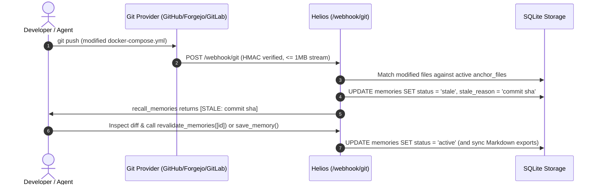
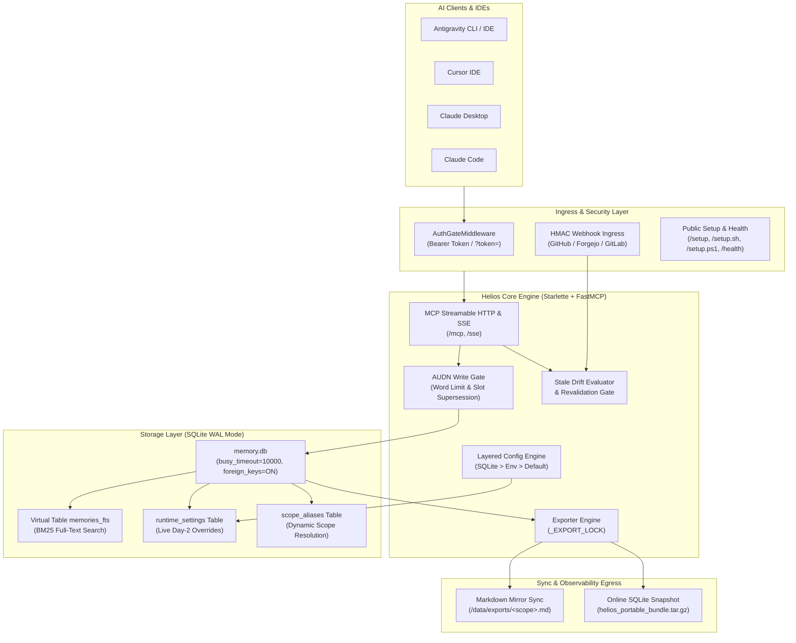
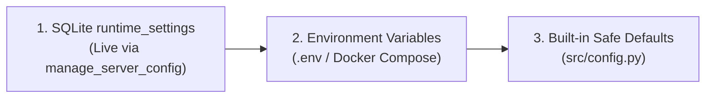

<div align="center">

# ☀️ Helios

**The Token-Budgeted, Drift-Aware MCP Memory Engine for AI Coding Agents**

[](https://github.com/brazaoo4/helios/actions/workflows/pipeline.yml)
[](https://github.com/brazaoo4/helios/pkgs/container/helios)
[](https://www.python.org/)
[](https://modelcontextprotocol.io/)
[](https://www.sqlite.org/fts5.html)
[](LICENSE)

*Stop repeating architectural context across sessions. Stop agents from acting on outdated documentation.*

[Why Helios?](#-why-helios) • [Quick Start](#-1-quick-start-server-deployment) • [1-Liner Client Setup](#-2-client-installation-for-ai-agents) • [How Drift Detection Works](#-3-how-git-drift-detection-works) • [Architecture](#%EF%B8%8F-4-system-architecture) • [MCP Tools](#%EF%B8%8F-5-mcp-tools-reference)

</div>

---

## 💡 Why Helios?

AI coding agents suffer from two fundamental failure modes: **amnesia** (forgetting ports, conventions, and architecture between sessions) and **knowledge drift** (trusting outdated facts after code and configuration files change).

| Approach | Token Overhead | Handles Contradictions? | Detects Code/Config Drift? | Cross-IDE / Multi-Host? |
| :--- | :--- | :--- | :--- | :--- |
| **Static `CLAUDE.md` / `GEMINI.md`** | High (loaded every turn) | ❌ Manual edits only | ❌ Silently goes stale | ❌ Per-machine / per-repo |
| **Vector / RAG Memory Servers** | High (dumps long chunks) | ❌ Keeps old & new facts | ❌ Blind to `git push` | ⚠️ Usually cloud-locked |
| **☀️ Helios** | **Ultra-Low (≤ 25 words/fact)** | **✅ Deterministic slot supersession** | **✅ Git webhooks flag `[STALE]`** | **✅ Shared across IDE, CLI & SSH** |

### Core Design Pillars

* **Strict Token Diet**: Enforces atomic, high-density facts (`≤ 25 words` by default) so agent context windows stay lean, fast, and focused.
* **Deterministic Lineage (AUDN Protocol)**: Facts operate on **A**dd, **U**pdate, **D**eprecate, or **N**o-op semantics. Saving a fact to an existing `(scope, subject)` slot automatically supersedes the old fact and logs the transition in a historical audit trail.
* **Git-Anchored Drift Detection**: Memories can be anchored to repo configuration files (e.g., `docker-compose.yml`, `prisma/schema.prisma`). When a `git push` modifies an anchored file on **GitHub, Forgejo, Gitea, or GitLab**, Helios automatically flags the memory as `[STALE]` so your agent inspects the diff before acting.
* **Dual-Plane Storage**: Sub-millisecond **SQLite WAL + FTS5 (BM25)** full-text search for agents, mirrored into human-readable **Markdown files** (`/data/exports/<scope>.md`) and crash-safe `.tar.gz` online snapshots for developers.
* **Live Day-2 Control Plane**: Change word limits, episodic TTLs, scope aliases, and Git webhooks conversationally from your IDE without restarting containers.

---

## 🚀 1. Quick Start: Server Deployment

Create a `compose.yaml` file (or paste directly into Dockhand / Portainer) and run `docker compose up -d`:

### `compose.yaml`

```yaml
services:
  helios:
    image: ghcr.io/brazaoo4/helios:latest
    # Or to build locally from source:
    # build: .
    container_name: helios
    restart: unless-stopped
    user: "1000:1000"  # Must match ownership of your host data directory
    ports:
      - "8000:8000"    # Omit if routing internally via a reverse proxy network
    volumes:
      # [MANDATORY] Persistent storage for SQLite WAL (memory.db) & Markdown exports
      - ./data:/data
    environment:
      # ========================================================================
      # 1. MANDATORY / CORE SETTINGS
      # ========================================================================
      - TZ=UTC
      - MEMORY_DATA_DIR=/data

      # ========================================================================
      # 2. RECOMMENDED SECURITY (Required if exposed outside a private LAN/VPN)
      # ========================================================================
      # Shared Bearer / ?token= key required for /mcp, /sse, and /export/*.
      # Leave empty ONLY if running on a trusted local network or Tailscale mesh.
      - HELIOS_API_KEY=
      # Shared HMAC-SHA256 secret for verifying POST /webhook/git payloads.
      # Generate with: openssl rand -hex 32
      - HELIOS_WEBHOOK_SECRET=
      - HELIOS_REQUIRE_WEBHOOK_SECRET=false

      # ========================================================================
      # 3. OPTIONAL: REVERSE PROXY & ENGINE TUNABLES (Also live-editable via MCP)
      # ========================================================================
      # Override base URL used in /setup scripts (auto-detected from proxy headers if empty)
      - HELIOS_PUBLIC_URL=
      - HELIOS_ALLOWED_ORIGINS=*
      - HELIOS_WORD_LIMIT=25
      - HELIOS_EPISODIC_TTL_DAYS=14
      - HELIOS_CHANGELOG_LIMIT=100

      # ========================================================================
      # 4. OPTIONAL: CONVERSATIONAL GIT WEBHOOK MANAGER (manage_git_webhooks)
      # ========================================================================
      # Only needed if you want your AI agent to list/enable repo webhooks via chat.
      # Leave empty if you prefer adding webhooks manually in your Git UI.
      - HELIOS_GIT_PROVIDER=     # forgejo | gitea | github | gitlab
      - HELIOS_GIT_API_URL=      # e.g., https://git.example.com or https://api.github.com
      - HELIOS_GIT_TOKEN=        # PAT with repo/webhook permissions
      - HELIOS_GIT_OWNER=        # Optional username/org filter
      - HELIOS_WEBHOOK_URL=      # e.g., https://helios.example.com/webhook/git
    healthcheck:
      test: ["CMD", "curl", "-fsS", "http://127.0.0.1:8000/health"]
      interval: 30s
      timeout: 5s
      retries: 3
```

### Pre-Flight Host Notes

* **Volume Permissions (`1000:1000`)**: Helios runs rootless as `uid=1000` (`gid=1000`). Ensure your host bind-mount directory is owned by `1000:1000` before starting:
  ```bash
  mkdir -p ./data && chown -R 1000:1000 ./data
  ```
* **Reverse Proxy (Nginx Proxy Manager / Caddy / Traefik)**: If exposing Helios over HTTPS, disable proxy buffering on your reverse proxy so SSE streams (`/sse` and `/mcp`) flush immediately:
  ```nginx
  proxy_buffering off;
  proxy_cache off;
  proxy_read_timeout 86400s;
  ```
* **Cold-Boot Seeding (Optional)**: If you drop a `seed.yaml` file (see [seed.example.yaml](seed.example.yaml)) into `./data/seed.yaml`, Helios will automatically ingest it on startup and rename it to `seed.yaml.imported`.

<details>
<summary><b>Building from Source (Alternative)</b></summary>

If you aren't pulling a pre-built image and want to build from the repository:

```bash
git clone https://github.com/brazaoo4/helios.git
cd helios
cp .env.example .env
mkdir -p data && chown -R 1000:1000 data
docker compose up -d --build
```

</details>

---

## ⚡ 2. Client Installation for AI Agents

Helios supports zero-friction onboarding across **Antigravity**, **Cursor**, **Claude Desktop**, and **Claude Code** on **Linux**, **macOS**, and **Windows**.

### 2.1 Conversational AI Setup (1 Prompt)

Paste this single prompt into your coding agent (Claude Code, Cursor, Antigravity):

```text
Fetch https://<your-helios-host>/setup and configure my local MCP client, global directives, and /remember skill.
```

The agent fetches `GET /setup`, detects your OS and IDE, safely merges the `"helios"` server entry into your MCP JSON configuration without overwriting existing servers, adds the Helios directive block, and installs the `/remember` skill.

### 2.2 Instant Terminal 1-Liner Setup

Or run the automated onboarding script directly in your terminal:

**Linux / macOS (Bash):**
```bash
curl -fsSL https://<your-helios-host>/setup.sh | bash
```

*Headless server CLI role (adds strict log-truncation rules like `--tail=50`):*
```bash
curl -fsSL "https://<your-helios-host>/setup.sh?role=server-cli" | bash
```

**Windows (PowerShell):**
```powershell
irm https://<your-helios-host>/setup.ps1 | iex
```

*Headless server CLI role:*
```powershell
irm "https://<your-helios-host>/setup.ps1?role=server-cli" | iex
```

> [!TIP]
> **Multi-Client Auto-Detection & Token Passing**:
> The setup scripts automatically detect and configure Antigravity (`mcp_config.json` + `GEMINI.md` + `/remember`), Cursor (`~/.cursor/mcp.json`), Claude Desktop (`claude_desktop_config.json`), and Claude Code (`claude mcp add`).
> If `HELIOS_API_KEY` is enabled, append `?token=<your_key>` to the setup URL.

#### Client Configuration Paths & Snippets

* **Antigravity CLI / IDE** (`~/.gemini/config/mcp_config.json` | `%USERPROFILE%\.gemini\config\mcp_config.json`):
  ```json
  {
    "mcpServers": {
      "helios": {
        "url": "https://<your-helios-host>/mcp"
      }
    }
  }
  ```

* **Cursor IDE** (`~/.cursor/mcp.json` | `%USERPROFILE%\.cursor\mcp.json`):
  ```json
  {
    "mcpServers": {
      "helios": {
        "url": "https://<your-helios-host>/sse"
      }
    }
  }
  ```

* **Claude Desktop** (`claude_desktop_config.json` in `~/.config/Claude` / `~/Library/Application Support/Claude` / `%APPDATA%\Claude`):
  ```json
  {
    "mcpServers": {
      "helios": {
        "command": "npx",
        "args": ["-y", "mcp-remote", "https://<your-helios-host>/sse"]
      }
    }
  }
  ```

* **Claude Code CLI**:
  ```bash
  claude mcp add --transport sse helios https://<your-helios-host>/sse
  ```

### 2.3 Safe In-Place Directive Management (`<!-- HELIOS:START -->`)

Helios encloses its global agent instructions inside idempotent HTML comment delimiters (`GEMINI.md` / `CLAUDE.md` / `.cursor/rules/helios.mdc`) so your personal custom rules are never overwritten:

```markdown
<!-- HELIOS:START -->
# Global Agent Directives — Helios Memory Protocol
You are connected to Helios, a centralized token-budgeted memory engine.
1. Pre-Flight Check: Always call `recall_memories(scope="<current_repo>")` at session start.
2. Stale Protocol: When a memory is marked `[STALE]`, inspect `anchor_files` before relying on it.
3. Update Rule: Persist architectural decisions, changed ports, or conventions via `save_memory()`.
4. Token Diet: Keep facts atomic (<= 25 words).
5. Wrap-Up: Run the `/remember` skill before clearing context.
<!-- HELIOS:END -->
```

* **Switch Machine Role (`workstation` ↔ `server-cli`)**:
  *"Run `get_client_setup_bundle(action='switch_role', instance_role='server-cli')` and update my directives."*
* **Clean Uninstall**:
  *"Run `get_client_setup_bundle(action='uninstall')` and remove Helios from this machine."*

---

## 🔄 3. How Git Drift Detection Works

When you save a memory tied to configuration files, Helios watches those files across commits:

```text
# 1. Agent saves an anchored architectural fact:
save_memory(
    scope="payments-api",
    category="fact",
    subject="db-pool",
    content="PostgreSQL connection pool runs via PgBouncer on internal port 6432.",
    anchor_files=["docker-compose.yml"]
)

# 2. Later, a developer pushes a commit modifying docker-compose.yml (commit a1b2c3d).
# Helios's webhook receiver automatically flags the memory as [STALE].

# 3. Next session, the agent runs pre-flight recall_memories(scope="payments-api"):
- #14 (payments-api/fact) **[db-pool]** PostgreSQL connection pool runs via PgBouncer on internal port 6432. `[STALE: docker-compose.yml modified in commit a1b2c3d]` _(anchors: `docker-compose.yml`)_

# 4. The agent inspects docker-compose.yml:
# - If the fact is still true: calls revalidate_memories(memory_ids=[14])
# - If the port changed: calls save_memory(..., subject="db-pool", content="...") to supersede #14!
```



---

## 🏗️ 4. System Architecture



### Layered Configuration Precedence

Runtime settings (`HELIOS_WORD_LIMIT`, `HELIOS_EPISODIC_TTL_DAYS`, `HELIOS_CHANGELOG_LIMIT`, `HELIOS_GIT_*`) resolve dynamically on every call without container restarts, while security boundaries (`HELIOS_API_KEY`, `HELIOS_WEBHOOK_SECRET`, `MEMORY_DATA_DIR`) remain locked to environment variables:



---

## 🛠️ 5. MCP Tools Reference

Helios exposes 10 FastMCP tools with strict Pydantic field descriptions and worker-thread offloading:

| Tool | Key Parameters | Purpose |
| :--- | :--- | :--- |
| `recall_memories` | `scope`, `query`, `category`, `status_filter`, `limit`, `include_global` | Search active/stale memories in `<scope>` via FTS5 BM25 ranking or categorical priority (`rule` → `fact` → `preference` → `episodic`). |
| `save_memory` | `scope`, `category`, `content`, `subject`, `anchor_files`, `replaces_id` | Save or supersede an atomic memory (≤ `HELIOS_WORD_LIMIT` words) and sync Markdown exports. |
| `revalidate_memories` | `memory_ids` | Batch-restore `[STALE]` memories back to active after verifying file changes. |
| `deprecate_memory` | `memory_id`, `reason` | Retire/archive an obsolete memory and log the reason in the scope's changelog. |
| `recall_history` | `scope`, `limit` | Inspect superseded and archived records for time-travel debugging. |
| `manage_scope_alias` | `alias`, `canonical_scope`, `action` | Manage aliases (`set`, `remove`, `list` with active/stale counts) or migrate scopes (`rename`). |
| `manage_server_config` | `action`, `key`, `value` | View or modify runtime settings live (`list`, `set`, `reset`) with automatic secret redaction. |
| `manage_git_webhooks` | `action`, `repos`, `include_forks` | Interactively list owned repos and enable/disable drift webhooks on GitHub, Forgejo, Gitea, or GitLab. |
| `get_client_setup_bundle` | `client`, `os_platform`, `instance_role`, `action` | Generate client MCP configs, `GEMINI.md` directives, and `/remember` skill (`install_or_update`, `switch_role`, `uninstall`). |
| `export_bundle` | _(none)_ | Trigger an online SQLite backup (`src_conn.backup`) and package `helios_portable_bundle.tar.gz`. |

<details>
<summary><b>View Python Tool Signatures & Type Annotations</b></summary>

```python
# 1. Search active and stale memories
recall_memories(
    scope: str = "global",
    query: str = "",
    category: Literal["rule", "fact", "preference", "episodic", ""] = "",
    status_filter: Literal["all", "active", "stale"] = "all",
    limit: int = 8,
    include_global: bool = True,
) -> str

# 2. Store or supersede an atomic memory
save_memory(
    scope: str,
    category: Literal["rule", "fact", "preference", "episodic"],
    content: str,
    subject: str = "",
    anchor_files: list[str] | None = None,
    replaces_id: int | None = None,
) -> str

# 3. Batch-clear [STALE] flags after verifying diffs
revalidate_memories(memory_ids: list[int]) -> str

# 4. Archive an obsolete memory
deprecate_memory(memory_id: int, reason: str = "") -> str

# 5. Inspect superseded/archived audit log
recall_history(scope: str = "global", limit: int = 10) -> str

# 6. Manage aliases, view scope counts, or rename scopes
manage_scope_alias(
    alias: str = "",
    canonical_scope: str = "",
    action: Literal["set", "remove", "list", "rename"] = "set",
) -> str

# 7. Live Day-2 server configuration
manage_server_config(
    action: Literal["list", "set", "reset"] = "list",
    key: str = "",
    value: str = "",
) -> str

# 8. Conversational Git webhook management
manage_git_webhooks(
    action: Literal["list", "enable", "disable"] = "list",
    repos: list[str] | None = None,
    include_forks: bool = False,
) -> str

# 9. Client onboarding & lifecycle management
get_client_setup_bundle(
    client: Literal["antigravity", "cursor", "claude-desktop", "claude-code", "all"] = "all",
    os_platform: Literal["linux", "macos", "windows", "auto"] = "auto",
    instance_role: Literal["workstation", "server-cli"] = "workstation",
    action: Literal["install_or_update", "switch_role", "uninstall"] = "install_or_update",
) -> str

# 10. Generate crash-safe portable backup archive
export_bundle() -> str
```

</details>

---

## 🌐 6. HTTP Endpoints & Organization Webhooks

### 6.1 HTTP Routes Reference

| Method & Path | Auth Required | Description |
| :--- | :--- | :--- |
| `GET /health` | No (Redacted) / Yes (Full) | Returns service health. Redacts database telemetry when `HELIOS_API_KEY` is active unless authenticated. |
| `GET /setup` | No | AI onboarding guide with non-destructive MCP config snippets. Accepts optional `?token=<key>`. |
| `GET /setup.sh` | No | 1-liner Linux/macOS Bash client installer (`curl -fsSL <url>/setup.sh \| bash`). |
| `GET /setup.ps1` | No | 1-liner Windows PowerShell client installer (`irm <url>/setup.ps1 \| iex`). |
| `GET /export/markdown` | Yes (if key set) | Lists generated Markdown scope export files and sizes. |
| `GET /export/bundle` | Yes (if key set) | Generates and downloads `helios_portable_bundle.tar.gz` (use `curl -sLJO <url>/export/bundle`). |
| `POST /webhook/git` | HMAC Signature | Universal Git push webhook receiver for `anchor_files` drift detection (1MB streaming cap). |
| `/mcp` | Yes (if key set) | MCP Streamable HTTP endpoint for modern protocol clients. |
| `/sse` | Yes (if key set) | MCP Server-Sent Events endpoint with session message support. |

### 6.2 Optional: Account-Wide / Organization Webhooks

In addition to selective per-repo activation via `manage_git_webhooks`, you can configure a single global webhook on your Git server:

* **Forgejo / Gitea**: Go to **Site Administration** → **Default Webhooks** (`/admin/hooks`) or Organization Settings → Webhooks, add `https://<helios-host>/webhook/git` (`POST`, `application/json`, `HELIOS_WEBHOOK_SECRET`, Push Events).
* **GitHub**: Go to **Organization Settings** → **Webhooks**, add `https://<helios-host>/webhook/git` (`application/json`, `HELIOS_WEBHOOK_SECRET`, Just the push event).

---

## 🧪 7. Testing & Local Development

```bash
# Set up virtual environment
python3 -m venv .venv
source .venv/bin/activate

# Install development dependencies
pip install -r requirements-dev.txt

# Run linter & complete test suite
ruff check src/ tests/
pytest tests/ -q

# Validate declarative seed fact invariants
python -m src.seed --check
```

---

## 📄 License

Helios is open-source software licensed under the [GNU Affero General Public License v3.0 (AGPL-3.0-only)](LICENSE).

See [CONTRIBUTING.md](CONTRIBUTING.md) for contribution guidelines and [SECURITY.md](SECURITY.md) for vulnerability reporting.
