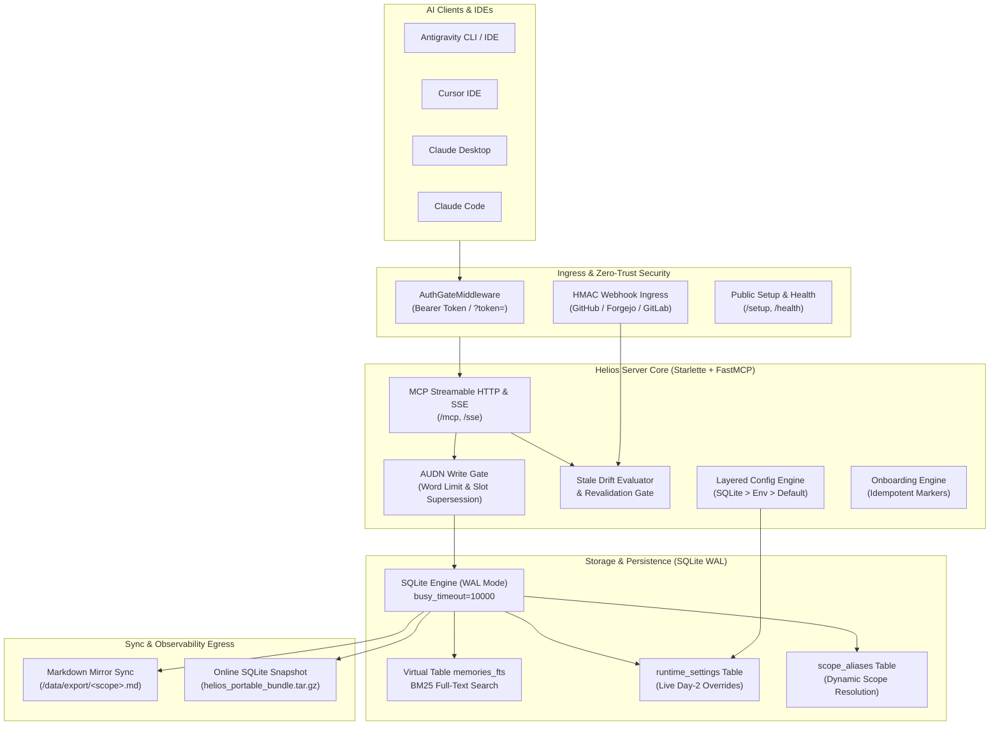
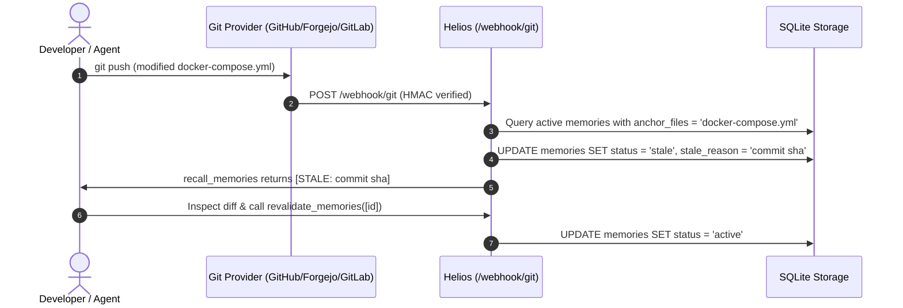

# Helios — Centralized MCP Memory Server

**Helios** is a token-budgeted Model Context Protocol (MCP) shared memory engine built for AI coding agents across IDEs, CLIs, local networks, and cloud deployments.

It provides sub-millisecond full-text retrieval via **SQLite FTS5 (BM25)**, deterministic **AUDN (Add / Update / Deprecate / No-op)** write gates, **universal Git webhook drift detection** (GitHub, Forgejo, Gitea, GitLab), **live Day-2 runtime configuration**, **zero-trust authentication**, and dual-faced **Markdown + portable `.tar.gz` exports**.

---

## Architecture & System Overview



---

## Key Capabilities

- **SQLite WAL & FTS5 (BM25) Full-Text Search**:
  - Sub-millisecond indexed memory retrieval across scopes with BM25 ranking.
  - Categorical priority ordering: `rule` (guardrails) $\rightarrow$ `fact` (architecture/ports) $\rightarrow$ `preference` (conventions) $\rightarrow$ `episodic` (temporary notes).
  - Trigram, prefix, and wildcard queries with automatic sanitization for technical tokens (e.g., `192.168.1.150:8000`, `docker-compose.yml`, `v0.1.0`).

- **AUDN Write Gate (`upsert_memory()`)**:
  - Enforces strict configurable word limits (`HELIOS_WORD_LIMIT`, default $\le$ 25 words) to eliminate LLM context bloat.
  - `BEGIN IMMEDIATE` transaction locking guarantees zero race conditions or write collisions.
  - Automatic `(scope, subject)` slot supersession: updating an existing subject atomically supersedes older records and preserves historical audit trails.
  - Exact-duplicate no-op pruning: refreshes `last_accessed` without creating redundant database records.

- **Automated Configuration Drift Tracking**:
  - Universal Git push webhook receiver compatible with **GitHub** (`X-Hub-Signature-256`), **Forgejo / Gitea** (`X-Forgejo-Signature`), and **GitLab** (`X-Gitlab-Token`).
  - Matches modified commit files against memory `anchor_files` (e.g., `docker-compose.yml`, `schema.prisma`, `package.json`), automatically flagging impacted memories as `[STALE: commit_sha]`.

- **Batch Stale Memory Revalidation (`revalidate_memories`)**:
  - Agents inspect git diffs on flagged `anchor_files` and revalidate stale memories back to `active` status in a single tool call, instantly refreshing Markdown exports.

- **Dynamic Scope Resolution & Migration (`migrate_scope`)**:
  - Dynamic `scope_aliases` table enables repository renames and multi-directory aliases without database restructuring.
  - Atomic scope migration (`manage_scope_alias(action="rename")`) seamlessly migrates records, supersedes slot collisions, repoints aliases, and purges ghost Markdown exports.

- **Live Day-2 Runtime Configuration (`manage_server_config`)**:
  - Allows AI agents to adjust server settings (`HELIOS_WORD_LIMIT`, `HELIOS_EPISODIC_TTL_DAYS`, `HELIOS_GIT_*`, etc.) live via MCP without restarting containers.
  - Layered resolution precedence: **SQLite `runtime_settings`** $\rightarrow$ **Environment variables** $\rightarrow$ **Built-in defaults**.
  - Immutable security locks protect sensitive operational keys (`HELIOS_API_KEY`, `HELIOS_WEBHOOK_SECRET`, `MEMORY_DATA_DIR`, `HELIOS_ALLOWED_ORIGINS`).

- **Conversational Git Webhook Management (`manage_git_webhooks`)**:
  - Audit, enable, and disable repository drift webhooks directly through conversational chat across Forgejo, Gitea, GitHub, and GitLab.
  - Strict ownership and fork filters safeguard against unwanted webhooks on third-party or archived repositories.

- **1-Prompt AI Client Setup & Lifecycle Management**:
  - `GET /setup` endpoint and `get_client_setup_bundle` tool generate self-contained MCP configuration snippets and global agent directives for Antigravity, Cursor, Claude Desktop, and Claude Code.
  - Injects idempotent markers (`<!-- HELIOS:START -->` ... `<!-- HELIOS:END -->`) to allow seamless role switching (`workstation` $\leftrightarrow$ `server-cli`) and clean uninstallation without clobbering existing instructions.

- **Zero-Trust Security & Public Ingress Hardening**:
  - Constant-time `hmac.compare_digest` AuthGate verifies `Authorization: Bearer <token>` or `?token=<token>`.
  - Automatic secret masking: sensitive values like `HELIOS_GIT_TOKEN` are masked as `•••••••• (configured)` in tool responses.
  - Redacts sensitive database telemetry from `GET /health` for unauthenticated callers.

- **Dual-Faced Exports & Backups**:
  - **Human-Readable Markdown**: Auto-synced `/data/export/<scope>.md` and `/data/export/changelog/<scope>_history.md`.
  - **Machine Snapshots**: Online SQLite database backup bundled into `helios_portable_bundle.tar.gz` via `export_bundle()` or `GET /export/bundle`.

---

## MCP Tools Reference

Helios registers 10 high-performance FastMCP tools with rich schema annotations:

| Tool | Parameters | Description |
| :--- | :--- | :--- |
| [`recall_memories`](#1-recall_memories) | `scope`, `query`, `category`, `status_filter`, `limit`, `include_global` | Search active or stale memories in `<scope>` using FTS5 BM25 ranking or categorical priority. |
| [`save_memory`](#2-save_memory) | `scope`, `category`, `content`, `subject`, `anchor_files`, `replaces_id` | Save or supersede an atomic memory ($\le$ `HELIOS_WORD_LIMIT` words) and sync Markdown exports. |
| [`revalidate_memories`](#3-revalidate_memories) | `memory_ids` | Batch revalidate stale memories back to `active` status after verifying updated configuration. |
| [`deprecate_memory`](#4-deprecate_memory) | `memory_id`, `reason` | Retire/archive an obsolete memory and log the deprecation reason to the scope changelog. |
| [`recall_history`](#5-recall_history) | `scope`, `limit` | Retrieve historical audit trail of superseded and archived memories for debugging. |
| [`manage_scope_alias`](#6-manage_scope_alias) | `alias`, `canonical_scope`, `action` | Manage aliases (`set`, `remove`, `list` with active/stale memory counts) or migrate scopes (`rename`). |
| [`manage_server_config`](#7-manage_server_config) | `action`, `key`, `value` | Inspect or update runtime configuration live (`list`, `set`, `reset`) with automatic secret masking. |
| [`manage_git_webhooks`](#8-manage_git_webhooks) | `action`, `repos`, `include_forks` | Interactively audit and attach drift webhooks across Forgejo, Gitea, GitHub, or GitLab (`list`, `enable`, `disable`). |
| [`get_client_setup_bundle`](#9-get_client_setup_bundle) | `client`, `os_platform`, `instance_role`, `action` | Retrieve client configuration, directives (`GEMINI.md`), and `/remember` skill (`install_or_update`, `switch_role`, `uninstall`). |
| [`export_bundle`](#10-export_bundle) | _(none)_ | Generate an online SQLite backup snapshot and package `helios_portable_bundle.tar.gz`. |

---

### Detailed Tool Documentation

#### 1. `recall_memories`
Search active and stale memories in `<scope>` (and optionally `global`).
```python
recall_memories(
    scope: str,                                                              # e.g., "homelab", "web-app", "global"
    query: str = "",                                                         # FTS5 keywords, phrases, or technical tokens
    category: Literal["rule", "fact", "preference", "episodic", ""] = "",    # Filter by classification
    status_filter: Literal["all", "active", "stale"] = "active",             # Filter by drift status
    limit: int = 15,                                                         # Max results (capped at 25)
    include_global: bool = True,                                             # Include universal rules/facts
) -> str
```

#### 2. `save_memory`
Store an atomic rule, fact, preference, or episodic memory.
```python
save_memory(
    scope: str,                                                              # Project or directory name
    category: Literal["rule", "fact", "preference", "episodic"],             # Memory classification
    content: str,                                                            # Statement (MUST be <= HELIOS_WORD_LIMIT words)
    subject: str = "",                                                       # Deterministic slot key (auto-supersedes existing slot)
    anchor_files: list[str] | None = None,                                   # Repo-relative paths triggering drift (e.g., ['compose.yml'])
    replaces_id: int | None = None,                                          # Explicit memory ID to supersede
) -> str
```

#### 3. `revalidate_memories`
Batch-restore stale memories back to `active` after inspecting git commit diffs.
```python
revalidate_memories(
    memory_ids: list[int]                                                    # List of integer memory IDs to revalidate
) -> str
```

#### 4. `deprecate_memory`
Retire an obsolete memory with an audit explanation.
```python
deprecate_memory(
    memory_id: int,                                                          # Memory ID to retire
    reason: str = ""                                                         # Deprecation reason for audit log
) -> str
```

#### 5. `recall_history`
Inspect superseded and archived records for time-travel debugging.
```python
recall_history(
    scope: str = "global",                                                   # Scope name to inspect
    limit: int = 10                                                          # Max historical entries (capped at 25)
) -> str
```

#### 6. `manage_scope_alias`
Create aliases, view scope statistics, or migrate scopes atomically.
```python
manage_scope_alias(
    alias: str = "",                                                         # Alias or source scope name
    canonical_scope: str = "",                                               # Target canonical scope name
    action: Literal["set", "remove", "list", "rename"] = "set"               # Action to perform
) -> str
```
- `action="list"`: Displays registered aliases and active/stale memory counts per scope:
  ```text
  ### Active Scopes in Memory
  - **homelab** (11 active, 2 stale) <- aliases: braserver, selfhost
  - **ticketera** (8 active, 0 stale) <- aliases: ticket-tracker
  ```
- `action="rename"`: Renames a scope atomically, supersedes subject collisions, updates aliases, and removes orphaned markdown files.

#### 7. `manage_server_config`
Day-2 runtime configuration tool for inspecting and modifying settings live.
```python
manage_server_config(
    action: Literal["list", "set", "reset"] = "list",                        # Action to perform
    key: str = "",                                                           # Setting name (e.g., 'HELIOS_WORD_LIMIT')
    value: str = ""                                                          # New value when action='set'
) -> str
```
- `action="list"`: Returns a markdown table showing all mutable settings, active values, provenance (`db`, `env`, `default`), and read-only security indicators.
- `action="set"`: Validates and persists setting to SQLite `runtime_settings`. Takes effect immediately without restarting.
- `action="reset"`: Deletes SQLite override and reverts setting to environment/default value.

#### 8. `manage_git_webhooks`
Conversational Git push webhook manager.
```python
manage_git_webhooks(
    action: Literal["list", "enable", "disable"] = "list",                   # Action to perform
    repos: list[str] | None = None,                                          # Target repo names (e.g., ['org/repo'])
    include_forks: bool = False                                              # Whether to include forks
) -> str
```

#### 9. `get_client_setup_bundle`
Generates client MCP JSON configs, global system directives, and the `/remember` skill.
```python
get_client_setup_bundle(
    client: Literal["antigravity", "cursor", "claude-desktop", "claude-code", "all"] = "all",
    os_platform: Literal["linux", "macos", "windows", "auto"] = "auto",
    instance_role: Literal["workstation", "server-cli"] = "workstation",
    action: Literal["install_or_update", "switch_role", "uninstall"] = "install_or_update"
) -> str
```

#### 10. `export_bundle`
Packages an online SQLite database backup into `helios_portable_bundle.tar.gz`.
```python
export_bundle() -> str
```

---

## Universal Git Webhook Drift Detection

Helios automatically detects configuration drift when git commits touch memory `anchor_files`.



### 1. Conversational Management (`manage_git_webhooks`)
To enable conversational webhook management through chat, configure Git provider settings in `.env`:
```bash
HELIOS_GIT_PROVIDER=forgejo  # forgejo, gitea, github, gitlab
HELIOS_GIT_API_URL=https://git.example.com
HELIOS_GIT_TOKEN=your_personal_access_token
HELIOS_WEBHOOK_URL=https://helios.example.com/webhook/git
```
Then ask your AI agent:
- *"List my Git repositories and check which ones have Helios drift tracking enabled."*
- *"Enable drift tracking on user/my-app and user/homelab."*
- *"Disable drift tracking on user/archived-project."*

### 2. Zero-Script Setup for All Repositories (Default & Org Webhooks)
- **Forgejo / Gitea Default Webhook**:
  1. Open **Site Administration** $\rightarrow$ **Default Webhooks** (`/admin/hooks`).
  2. Click **Add Webhook** $\rightarrow$ **Gitea** (or Forgejo).
  3. Set **Target URL** to `https://<helios-host>/webhook/git`.
  4. Set **HTTP Method** to `POST` and **Content Type** to `application/json`.
  5. Enter the **Secret** matching `HELIOS_WEBHOOK_SECRET`.
  6. Trigger on **Push Events** and save. Every future repository automatically inherits drift tracking.

- **GitHub Organization Webhook**:
  1. Open Organization **Settings** $\rightarrow$ **Webhooks** (`https://github.com/organizations/<org>/settings/hooks`).
  2. Click **Add webhook**.
  3. Set **Payload URL** to `https://<helios-host>/webhook/git`.
  4. Set **Content type** to `application/json`.
  5. Enter the **Secret** matching `HELIOS_WEBHOOK_SECRET`.
  6. Select **Just the push event** and save.

---

## Live Day-2 Configuration Management

Settings can be changed dynamically without restarting the Helios container:

| Setting | Type | Range / Choices | Default | Description |
| :--- | :--- | :--- | :--- | :--- |
| `HELIOS_WORD_LIMIT` | `int` | `5` – `200` | `25` | Strict word limit per atomic memory statement |
| `HELIOS_EPISODIC_TTL_DAYS` | `int` | `1` – `365` | `14` | Inactivity days before episodic memories archive |
| `HELIOS_CHANGELOG_LIMIT` | `int` | `10` – `1000` | `100` | Historical changelog rows retained per scope |
| `HELIOS_PUBLIC_URL` | `str` | URL string | `""` | Public/mesh base URL override for `/setup` |
| `HELIOS_GIT_PROVIDER` | `str` | `""`, `forgejo`, `gitea`, `github`, `gitlab` | `""` | Git provider for conversational webhooks |
| `HELIOS_GIT_API_URL` | `str` | URL string | `""` | Base API URL of your Git provider instance |
| `HELIOS_GIT_OWNER` | `str` | Username / Org | `""` | Filter repos by owner (defaults to token owner) |
| `HELIOS_GIT_TOKEN` | `str` | Sensitive token | `None` | Personal Access Token with repo/webhook scope |
| `HELIOS_WEBHOOK_URL` | `str` | URL string | `""` | Target webhook URL registered on Git providers |

> [!IMPORTANT]
> **Security Invariant**: `MEMORY_DATA_DIR`, `HELIOS_API_KEY`, `HELIOS_WEBHOOK_SECRET`, and `HELIOS_ALLOWED_ORIGINS` are immutable at runtime and can only be set via environment variables.

---

## 1-Prompt AI Client Setup & Lifecycle

### 1. Instant Agent Connection
Once Helios is running, paste this single prompt into any IDE or CLI agent on any machine:

```text
Fetch https://<your-helios-domain>/setup and configure my local MCP client, global directives, and /remember skill.
```

The agent fetches `GET /setup`, identifies its client environment and OS platform, safely merges the `"helios"` configuration into its MCP configuration file without overwriting other servers, installs the global directive, and installs the `/remember` skill.

### 2. Client Lifecycle & Idempotent Delimiters
Helios encloses all injected directives inside idempotent delimiters:
```markdown
<!-- HELIOS:START -->
# Instance Context: workstation
- **Pre-Flight Memory Check**: Always call `recall_memories(scope="<project_or_scope>")` before modifying code or configs.
- **AUDN Memory Synthesis**: Call `save_memory` for architectural decisions, rules, and facts (STRICT LIMIT: <= 25 words).
<!-- HELIOS:END -->
```

- **Switching Roles**: To switch an agent between desktop development (`workstation`) and headless server management (`server-cli`), ask your agent:
  *"Run `get_client_setup_bundle(action='switch_role', instance_role='server-cli')` and update my directives."*
- **Clean Uninstallation**: To cleanly decouple an agent, ask your agent:
  *"Run `get_client_setup_bundle(action='uninstall')` and remove Helios from this machine."*

---

## HTTP Endpoints Reference

| Method & Path | Auth Required | Description |
| :--- | :--- | :--- |
| `GET /health` | No (Redacted) / Yes (Full) | Health check returning status. Redacts database telemetry when `HELIOS_API_KEY` is active unless authenticated. |
| `GET /setup` | No | Self-contained AI onboarding guide with non-destructive MCP config snippets. Accepts optional `?token=<key>`. |
| `GET /export/markdown` | Yes (if key configured) | Lists active Markdown scope exports and file sizes. |
| `GET /export/bundle` | Yes (if key configured) | Generates and streams `helios_portable_bundle.tar.gz`. |
| `POST /webhook/git`<br>`POST /webhook/forgejo`<br>`POST /hooks/git-commit` | HMAC Signature | Universal Git push webhook receiver for `anchor_files` drift detection. |
| `/mcp` | Yes (if key configured) | MCP Streamable HTTP endpoint for modern protocol clients. |
| `/sse` | Yes (if key configured) | MCP Server-Sent Events endpoint with backward compatibility. |

---

## Environment Variables Reference

| Variable | Default | Description |
| :--- | :--- | :--- |
| `MEMORY_DATA_DIR` | `/data` | Path inside container where SQLite (`memory.db`) and Markdown exports live. |
| `HELIOS_API_KEY` | `""` (Open Mode) | Zero-trust authentication key. Enables constant-time `hmac.compare_digest` verification. |
| `HELIOS_WEBHOOK_SECRET` | `""` | Shared secret for validating incoming Git push webhooks (`POST /webhook/git`). |
| `HELIOS_REQUIRE_WEBHOOK_SECRET` | `false` | Enforce fail-closed rejection (503) if `HELIOS_WEBHOOK_SECRET` is unset. |
| `HELIOS_WORD_LIMIT` | `25` | Maximum words allowed per atomic memory statement (5–200). |
| `HELIOS_EPISODIC_TTL_DAYS` | `14` | Days before unaccessed `episodic` memories are archived (1–365). |
| `HELIOS_CHANGELOG_LIMIT` | `100` | Historical records retained per scope in Markdown changelogs (10–1000). |
| `HELIOS_ALLOWED_ORIGINS` | `*` | Comma-separated list of allowed CORS origins. |
| `HELIOS_PUBLIC_URL` | `""` | Public/mesh base URL override for client `/setup` generation. |
| `HELIOS_GIT_PROVIDER` | `""` | Git provider (`forgejo`, `gitea`, `github`, `gitlab`). |
| `HELIOS_GIT_API_URL` | `""` | Base API URL of your Git server (e.g., `https://git.example.com`). |
| `HELIOS_GIT_TOKEN` | `""` | Personal Access Token with repo/webhook permissions. |
| `HELIOS_GIT_OWNER` | `""` | Filter repos by owner/org (defaults to token owner). |
| `HELIOS_WEBHOOK_URL` | `""` | Public webhook URL registered on Git providers. |

---

## Quick Start & Deployment

### 1. Docker Compose Deployment
```bash
# Clone the repository
git clone https://forgejo.braserver.site/braz/helios.git
cd helios

# Configure environment
cp .env.example .env
cp docker-compose.example.yml docker-compose.yml
mkdir -p data

# Optional: Place cold-start seed file
cp seed.example.yaml data/seed.yaml

# Start container
docker compose up -d --build
```

### 2. Reverse Proxy Example (Traefik)
```yaml
services:
  helios:
    image: helios:latest
    container_name: helios
    restart: unless-stopped
    user: "1000:1000"
    cap_drop:
      - ALL
    security_opt:
      - no-new-privileges:true
    env_file:
      - .env
    volumes:
      - ./data:/data
    networks:
      - web
    labels:
      - "traefik.enable=true"
      - "traefik.http.routers.helios.rule=Host(`helios.example.com`)"
      - "traefik.http.routers.helios.entrypoints=websecure"
      - "traefik.http.routers.helios.tls.certresolver=letsencrypt"
      - "traefik.http.services.helios.loadbalancer.server.port=8000"

networks:
  web:
    external: true
```

### 3. Local Development & Testing
```bash
# Set up virtual environment
python3 -m venv .venv
source .venv/bin/activate

# Install development dependencies
pip install -r requirements-dev.txt

# Run complete test suite (86 tests)
pytest tests/ -q
```

---

## License

Helios is open-source software licensed under the [MIT License](LICENSE).
