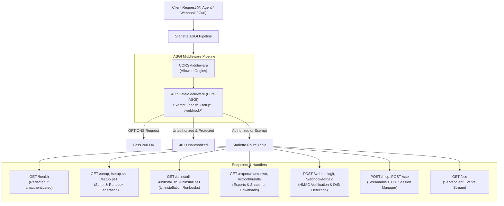
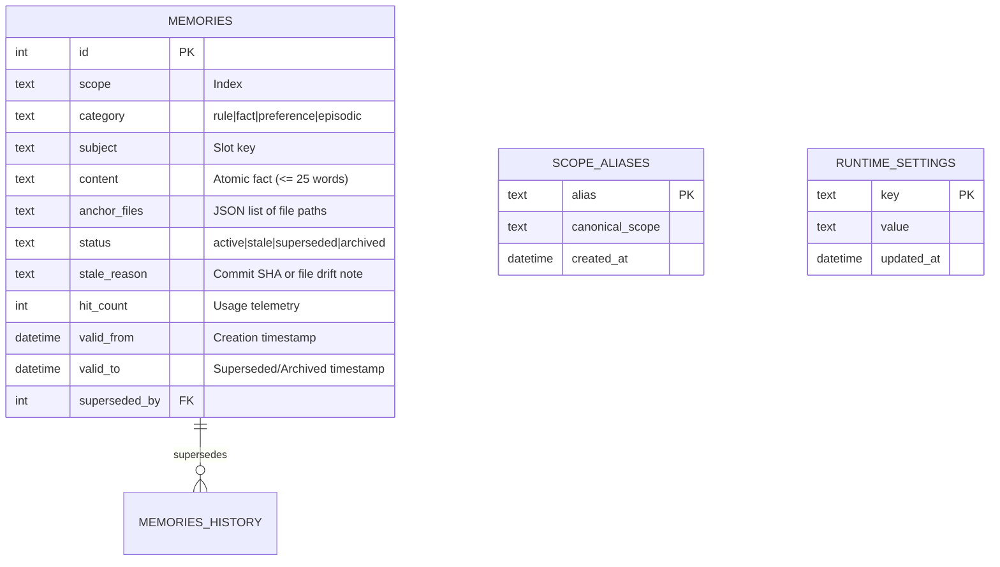

# 🏛️ Helios System Architecture & Technical Design

This document serves as the comprehensive architectural specification for **Helios**, detailing the system design, modular package structure, execution lifecycle, storage model, and testing patterns.

---

## 1. High-Level Architecture Overview

Helios is a lightweight, token-budgeted Model Context Protocol (MCP) memory engine and developer coordination daemon. It keeps AI coding agents grounded across sessions while maintaining strict bounds on agent context consumption.

### Core Architectural Invariants:
1. **Asynchronous Non-Blocking Execution**: Starlette's `asyncio` event loop must never be blocked. Heavy operations (database transactions, SQLite online backups, Markdown disk I/O, Git HTTP calls) are offloaded to worker threads via `anyio.to_thread.run_sync`.
2. **Single-Writer SQLite WAL Storage**: SQLite in Write-Ahead Logging (`WAL`) mode with `busy_timeout=10000` provides sub-millisecond concurrent read access alongside safe sequential writes.
3. **Lexical Full-Text Search (FTS5 BM25)**: Fast, dependency-free full-text search with BM25 ranking and categorical sorting (`rule` → `fact` → `preference` → `episodic`).
4. **AUDN Write Gate**: Deterministic memory lifecycle (**A**dd, **U**pdate, **D**eprecate, **N**o-op) preventing unbounded growth and silently conflicting instructions.
5. **Git-Anchored Drift Detection**: Memories anchored to repository files (`anchor_files`) are automatically flagged as `[STALE]` via universal Git push webhooks when commits touch those files.
6. **Dual-Plane Storage**: Machine-speed SQLite WAL for AI agents, mirrored into human-readable Markdown files (`/data/exports/<scope>.md`) and portable tar.gz archives for developers.

---

## 2. Codebase & Package Organization

The codebase is organized into focused, single-responsibility packages following standard enterprise Python architecture:

```text
src/
├── server.py              # Composition root (< 130 lines) & backward-compatible re-exports
├── config.py              # 3-tier layered settings engine (SQLite > Environment > Defaults)
├── db/                    # Modular SQLite Database Engine
│   ├── __init__.py        # Re-exports complete engine contract with __all__ (100% backward compatible)
│   ├── connection.py      # Connection factory, WAL pragmas, DB path resolution, timestamps
│   ├── schema.py          # Idempotent DDL, triggers, indexes, FTS5 virtual table
│   ├── settings.py        # Day-2 runtime settings key-value store (runtime_settings)
│   ├── scopes.py          # Scope aliasing, normalization, stats, cross-scope migration
│   ├── memories.py        # AUDN write gate, slot supersession, deprecation, revalidation, TTL pruning
│   ├── search.py          # FTS5 synonym clusters, query building, weighted BM25 ranking
│   ├── drift.py           # Git anchor file matching, repo path normalization
│   └── audit.py           # Distillation health scans, slot collision Jaccard analysis, pruning
├── exporter.py            # Thread-safe Markdown export mirroring & portable tar.gz backup
├── onboarding/            # Automated client onboarding, directive templates, and setup scripts
│   ├── __init__.py        # Re-exports for onboarding package and backward compatibility
│   ├── client_config.py   # Client registry, MCP paths, snippets, and base URL resolution
│   ├── templates.py       # Global agent directives, /remember skill, and cognitive guard hook
│   ├── bundles.py         # Multi-client setup bundle generation and Markdown guides
│   ├── scripts_setup.py   # Automated Bash and PowerShell setup script generation
│   └── scripts_uninstall.py # Automated uninstallation script generation
├── webhooks.py            # Git provider integrations (GitHub, Forgejo/Gitea, GitLab)
├── seed.py                # Declarative seed validator and ingestion runner
│
├── middleware/            # Security, transport routing, and application lifecycle
│   ├── __init__.py        # Re-exports for middleware package
│   ├── auth.py            # AuthGateMiddleware (pure ASGI), HMAC validation, bounded stream reader
│   ├── transport.py       # HybridMCPHandler (Streamable HTTP POST + SSE GET) & session fallback
│   └── lifespan.py        # Starlette lifespan manager, declarative seed ingestion, session loop
│
├── routes/                # Starlette HTTP REST endpoints
│   ├── __init__.py        # starlette_routes table assembly
│   ├── health.py          # GET /health with zero-trust authenticated database telemetry redaction
│   ├── setup.py           # GET /setup, /setup.sh, /setup.ps1, /uninstall, /uninstall.sh, /uninstall.ps1
│   ├── exports.py         # GET /export/markdown, GET /export/bundle (tar.gz download)
│   └── git_webhooks.py    # POST /webhook/git, POST /webhook/forgejo (universal Git push ingress)
│
└── tools/                 # FastMCP Tools (11 tools with explicit ToolAnnotations)
    ├── __init__.py        # Tool package exports & registration confirmation
    ├── base.py            # FastMCP singleton, instructions, sync thread-offloading monkeypatch
    ├── memory.py          # recall_memories, save_memory, deprecate_memory, revalidate_memories, recall_history, distill_memories
    ├── config.py          # manage_server_config, manage_scope_alias
    └── admin.py           # get_client_setup_bundle, export_bundle, manage_git_webhooks
```

### Module Responsibilities:

| Module / Package | Primary Responsibility |
| :--- | :--- |
| **`src/server.py`** | **Composition Root**: Assembles Starlette routes, registers ASGI middleware, initializes lifespan, and preserves public API backward compatibility via `__all__`. |
| **`src/middleware/auth.py`** | **Zero-Trust Security**: Pure ASGI middleware enforcing constant-time token verification (`Authorization: Bearer` or `?token=`) while exempting public endpoints (`/health`, `/setup*`, `/webhook/*`). Enforces 1MB streaming body caps (`_read_bounded_body`). |
| **`src/middleware/transport.py`** | **Protocol Multiplexing**: Dispatches `/sse` and `/mcp` requests to FastMCP's Streamable HTTP session manager or Server-Sent Events transport, gracefully falling back to standard SSE when stale session IDs are presented. |
| **`src/middleware/lifespan.py`** | **Lifecycle Management**: Runs on server boot to initialize SQLite WAL, ingest declarative `seed.yaml` / `seed.json` files, run auto-seeding if enabled, and initialize FastMCP's background session runner. |
| **`src/routes/`** | **HTTP Ingress**: REST route handlers exposing health checks, automated onboarding runbooks, Markdown export catalogs, snapshot downloads, and multi-provider Git push webhooks. |
| **`src/tools/`** | **MCP Tool Interfaces**: Declares the 11 MCP tools exposed to AI agents, with strict Pydantic schemas, explicit `ToolAnnotations`, and automatic worker-thread execution offloading. |
| **`src/config.py`** | **Configuration Resolution**: Layered settings manager resolving runtime variables across SQLite `runtime_settings`, host environment variables, and built-in safe defaults. |
| **`src/db/`** | **Data Persistence Engine**: Modular SQLite storage layer with WAL concurrency, FTS5 BM25 search, Day-2 runtime settings, scope aliasing/migration, AUDN write gate, Git drift tracking, and distillation auditing. |
| **`src/exporter.py`** | **Export Pipeline**: Synchronizes database state into disk Markdown files using `_EXPORT_LOCK` and creates consistent snapshots via the SQLite Online Backup API. |
| **`src/onboarding/`** | **Client Onboarding & Lifecycle**: Generates multi-platform setup/uninstall scripts (Bash, PowerShell), agent directive templates, `/remember` skill definitions, and MCP config snippets across 8 client ecosystems. |

---

## 3. Request Lifecycle & Ingress Flow

Every incoming HTTP request flows through the ASGI middleware pipeline before reaching its target handler:



---

## 4. FastMCP Integration & Thread Offloading

FastMCP tools in Python are executed on the main event loop by default. If a tool executes synchronous SQLite queries or disk I/O, it would block Starlette from responding to concurrent SSE connections or HTTP requests.

Helios solves this by intercepting FastMCP tool execution at the framework level in [`src/tools/base.py`](file:///home/braz/projects/helios/src/tools/base.py):

```python
# Encapsulated in src/tools/base.py
if FuncMetadata is not None and not getattr(FuncMetadata, "_helios_offloaded", False):
    _orig_call_fn = FuncMetadata.call_fn_with_arg_validation

    async def _offloaded_call_fn(self, fn, fn_is_async, args_to_validate, args_to_pass_directly):
        arguments_pre_parsed = self.pre_parse_json(args_to_validate)
        arguments_parsed_model = self.arg_model.model_validate(arguments_pre_parsed)
        arguments_parsed_dict = arguments_parsed_model.model_dump_one_level()
        arguments_parsed_dict |= args_to_pass_directly or {}

        if fn_is_async:
            return await fn(**arguments_parsed_dict)
        else:
            return await anyio.to_thread.run_sync(functools.partial(fn, **arguments_parsed_dict))

    FuncMetadata.call_fn_with_arg_validation = _offloaded_call_fn
    FuncMetadata._helios_offloaded = True
```

### Architectural Benefits:
1. **Preserves Tool Annotations**: Tool metadata, Pydantic field schemas, parameter descriptions, and `ToolAnnotations` (`readOnlyHint`, `destructiveHint`, `idempotentHint`, `openWorldHint`) are 100% preserved.
2. **Synchronous Direct Invocability**: Tools remain standard synchronous Python functions that can be tested in unit tests without requiring `asyncio.run()`.
3. **Zero Starlette Event Loop Lag**: All database queries and disk operations execute on AnyIO worker threads.

---

## 5. Storage Layer & Concurrency Model



### Storage Invariants:
1. **WAL Mode**: `PRAGMA journal_mode=WAL;` and `PRAGMA busy_timeout=10000;` ensure write transactions do not block concurrent readers.
2. **Full-Text Search & Synonym Expansion**: Virtual table `memories_fts` using SQLite FTS5 indexes `scope`, `subject`, and `content`. Queries automatically expand across 10 developer/DevOps domain clusters (databases, networking, auth, env, git, etc.) and rank via column-weighted BM25 (`bm25(memories_fts, 5.0, 10.0, 1.0)`) prioritizing slot subjects and scopes over body content.
3. **Markdown Export Locking**: All writes to disk Markdown files (`/data/exports/<scope>.md`) acquire an in-process threading lock (`_EXPORT_LOCK`) to guarantee sequential, uncorrupted writes.
4. **Online Backup API**: `/export/bundle` and `export_bundle()` utilize the SQLite C-level Online Backup API (`src_conn.backup(dest_conn)`) to create live snapshots without locking readers or writers.

---

## 6. Testing Architecture & Test Isolation

The test suite mirrors the application package structure under `tests/`:

```text
tests/
├── conftest.py                     # Centralized environment & SQLite isolation fixtures
├── middleware/
│   ├── test_auth.py                # AuthGateMiddleware & pure ASGI SSE stream tests
│   └── test_transport.py           # Transport security, reverse proxy, and session fallback tests
├── routes/
│   ├── test_health_routes.py       # Health check open mode & authenticated redaction tests
│   ├── test_setup_routes.py        # HTTP onboarding endpoints (/setup, /setup.sh, /uninstall, etc.)
│   ├── test_exports_routes.py      # /export/markdown and /export/bundle tar.gz tests
│   └── test_git_webhooks_routes.py # Multi-provider Git signature & drift detection tests
├── tools/
│   ├── test_tool_registry.py       # FastMCP schema, ToolAnnotations, and async worker offloading tests
│   ├── test_memory_tools.py        # AUDN lifecycle, drift, word budget, and hit tracking tests
│   ├── test_config_tools.py        # Day-2 live server configuration & scope alias tests
│   └── test_admin_tools.py         # Snapshot archive & operational tool tests
├── onboarding/
│   ├── test_client_config.py       # Client registry, paths, snippets, and URL resolution tests
│   ├── test_templates.py           # Directives, remember skill, and guard hook template tests
│   ├── test_bundles.py             # Setup bundle tool and markdown generation tests
│   ├── test_scripts_setup.py       # Bash/PowerShell setup script execution & injection tests
│   └── test_scripts_uninstall.py   # Clean uninstallation and user settings preservation tests
├── test_db.py                      # Core SQLite schema, FTS5 BM25, and migration tests
├── test_exporter.py                # Markdown export synchronization and atomicity tests
├── test_guard.py                   # Cognitive write-through guard hook tests
├── test_onboarding.py              # Package re-exports contract and static scanner invariant tests
├── test_seed.py                    # Declarative seed file ingestion & validation tests
└── test_server.py                  # Composition root lifespan and public re-export contract tests
```

### Conftest Isolation Design (`tests/conftest.py`):
- Every single test receives a fresh temporary SQLite database via `@pytest.fixture(autouse=True) def isolated_helios_env(tmp_path, monkeypatch)`.
- All Helios environment variables (`HELIOS_API_KEY`, `HELIOS_WEBHOOK_SECRET`, `HELIOS_WORD_LIMIT`, `HELIOS_GIT_*`, `HELIOS_AUTO_SEED`, etc.) are explicitly scrubbed per test to prevent host-environment leakage.
- Direct backward-compatibility verification in `tests/test_server.py` ensures that all public symbols remain importable directly from `src.server`.
